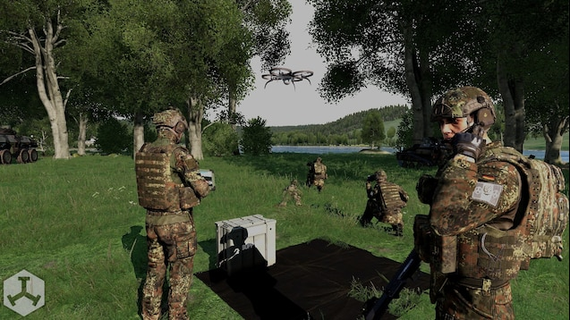

# Drone Addon

The `drone` addon registers deployable drone landing tarps by configuring the shared `common` framework.

## What it adds

- Four deployable tarp item variants (black, green, red, yellow).
- A helper `Land_HelipadEmpty_F` object created on deploy to support landing logic.
- Cleanup of the helper helipad on deconstruct.

### Classnames

- `tt_drone_tarp_Black`
- `tt_drone_tarp_Red`
- `tt_drone_tarp_Green`
- `tt_drone_tarp_Yellow`

#### Example

``` cpp
player addItemToBackpack "tt_drone_tarp_Green";
```

## Settings

### `tt_drone_buildTime`

- Type: `SLIDER`
- Range: `2` to `60`
- Default: `6`
- Purpose: build time for deploying drone tarp.

### `tt_drone_useAnimation`

- Type: `CHECKBOX`
- Default: `true`
- Purpose: toggle animation during deploy/deconstruct progress bars.

### `tt_drone_buildAnimation`

- Type: `EDITBOX`
- Default: `Acts_carFixingWheel`
- Purpose: animation class used while building/packing.

### Complete example

``` cpp
// cba_settings.sqf example
force tt_drone_buildTime = 10; // default: 6
force tt_drone_useAnimation = false; // default: true
force tt_drone_buildAnimation = "Acts_carFixingEngine"; // default: Acts_carFixingWheel
```

## Preview


