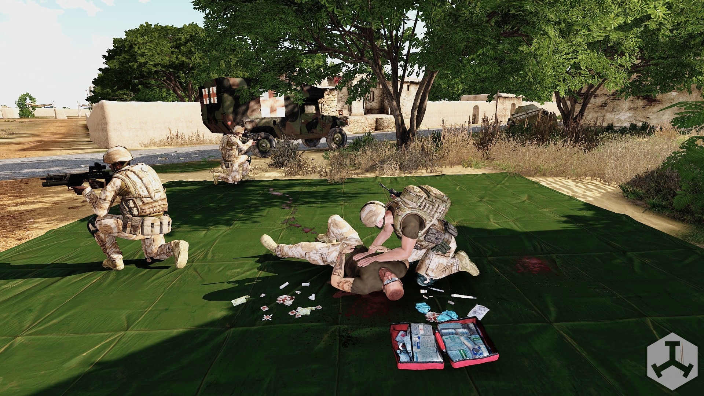

# Medic Addon

The `medic` addon registers deployable medical tarps with optional spawned support items.

## What it adds

- Four deployable medical tarp variants.
- `ace_medical_isMedicalFacility` enabled on deployed tarp object.
- Optional spawn and cleanup of additional configured medical objects.

### Classnames

- `tt_medic_tarp_Black`
- `tt_medic_tarp_Red`
- `tt_medic_tarp_Green`
- `tt_medic_tarp_Yellow`

#### Example

``` cpp
player addItemToBackpack "tt_medic_tarp_Red";
player addItemToBackpack "tt_medic_tarp_Yellow";
player addItemToBackpack "tt_medic_tarp_Green";
```

## Settings

### `tt_medic_additionalItems`

- Type: `EDITBOX`
- Default: `[]`
- Expected format: SQF array string, for example `["Land_MedicalTent_01_MTP_closed_F"]`
- Purpose: classnames to spawn around deployed tarp.

### `tt_medic_buildTime`

- Type: `SLIDER`
- Range: `2` to `60`
- Default: `6`
- Purpose: deploy/deconstruct duration.

### `tt_medic_useAnimation`

- Type: `CHECKBOX`
- Default: `true`
- Purpose: toggle build animation usage.

### `tt_medic_buildAnimation`

- Type: `EDITBOX`
- Default: `Acts_carFixingWheel`
- Purpose: animation class while interacting.

### Complete example

``` cpp
// cba_settings.sqf example
force tt_medic_additionalItems = '["Land_MedicalTent_01_MTP_closed_F","Land_PortableLight_single_F"]'; // default: []
force tt_medic_buildTime = 12; // default: 6
force tt_medic_useAnimation = false; // default: true
force tt_medic_buildAnimation = "AinvPknlMstpSnonWnonDnon_medicUp1"; // default: Acts_carFixingWheel
```

## Preview


