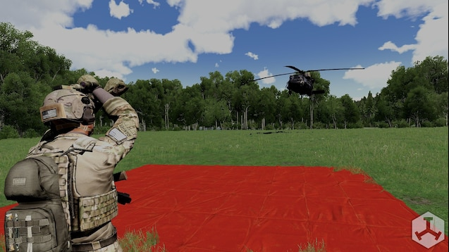

# Signal Addon

The `signal` addon registers deployable signal tarps for visual marking, especially LZ indication.

## What it adds

- Four deployable signal tarp variants.
- Invulnerability handler on deployed tarp object.
- Standard construct/deconstruct behavior from `common`.

### Classnames

- `tt_signal_tarp_Black` (not recommended)
- `tt_signal_tarp_Red`
- `tt_signal_tarp_Green` (not recommended)
- `tt_signal_tarp_Yellow`

#### Example

``` cpp
player addItemToBackpack "tt_signal_tarp_Red";
```

## Settings

### `tt_signal_buildTime`

- Type: `SLIDER`
- Range: `2` to `60`
- Default: `6`
- Purpose: deploy/deconstruct duration.

### `tt_signal_useAnimation`

- Type: `CHECKBOX`
- Default: `true`
- Purpose: toggle build animation usage.

### `tt_signal_buildAnimation`

- Type: `EDITBOX`
- Default: `Acts_carFixingWheel`
- Purpose: animation class while interacting.

### Complete example

``` cpp
// cba_settings.sqf example
force tt_signal_buildTime = 8; // default: 6
force tt_signal_useAnimation = false; // default: true
force tt_signal_buildAnimation = "Acts_carFixingEngine"; // default: Acts_carFixingWheel
```

## Preview


