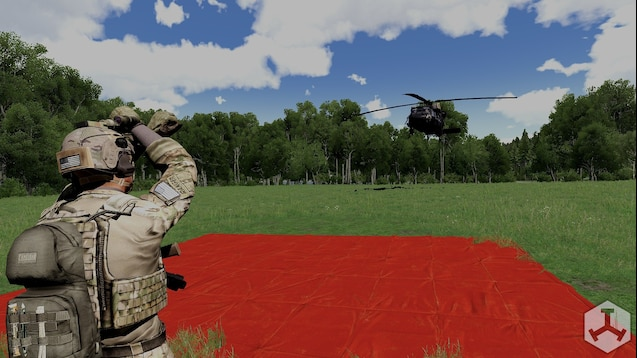

# Signal Addon

The `signal` addon registers deployable signal tarps for visual marking, especially LZ indication.

## What it adds

- Four deployable signal tarp variants.
- Invulnerability handler on deployed tarp object.
- Standard construct/deconstruct behavior from `common`.

### Classnames

- `tt_signal_tarp_Black` (not recommended)
- `tt_signal_tarp_Red`
- `tt_signal_tarp_Green` (not recommended)
- `tt_signal_tarp_Yellow`

#### Example

``` cpp
player addItemToBackpack "tt_signal_tarp_Red";
```

## Preview


